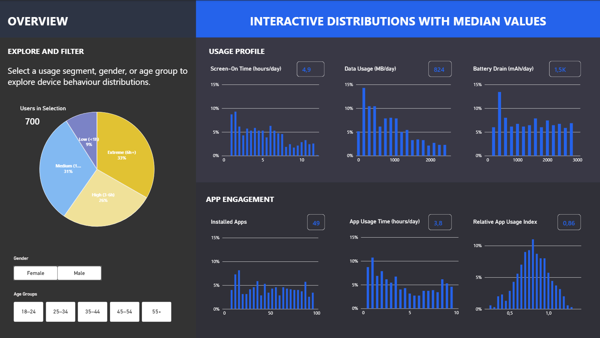
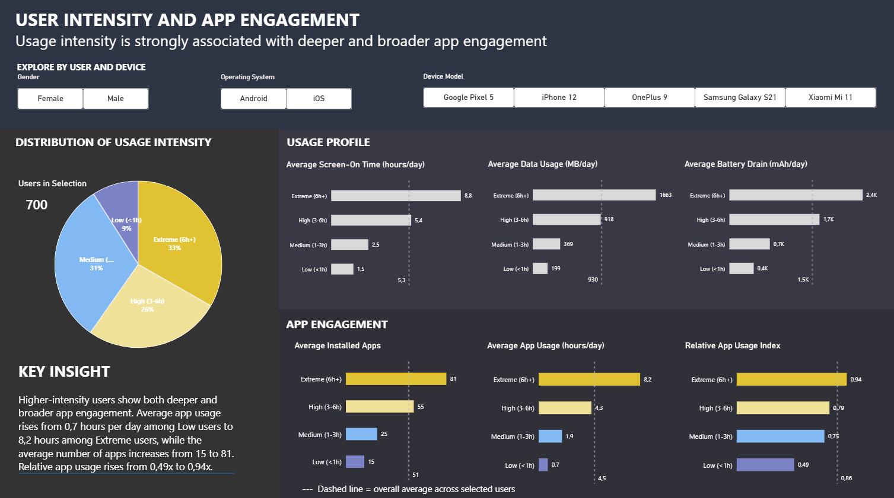
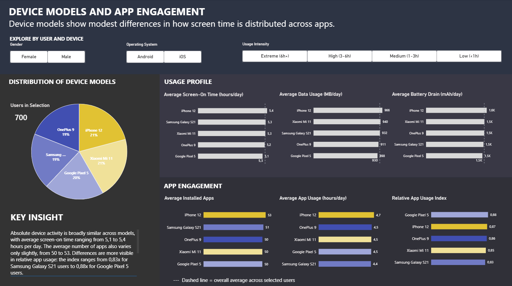

# Decoding Device Behaviour

An interactive Power BI dashboard that translates mobile-device telemetry into user segments, engagement patterns and hypotheses about app usage, data consumption and battery performance.

> **Data note:** The underlying Kaggle dataset is **synthetic** (see [Data citation](#data-citation)). The findings below describe patterns in this dataset; they are not evidence about real users.

## Interactive Distributions and Medians



This overview page provides an interactive view of device behaviour across the user population. It combines distribution charts with median KPI cards to show both the shape of each metric and the typical value within the currently selected user group.

### Explore and filter

- **Usage intensity:** four segments defined in the preprocessing notebook by binning **App Usage Time (min/day)**: Low (up to 1 h), Medium (1–3 h), High (3–6 h) and Extreme (above 6 h). The source dataset's own 1–5 "User Behavior Class" is not used.
- **Gender**
- **Age group:** 18–24, 25–34, 35–44, 45–54 and 55+

Selecting a usage-intensity segment highlights its contribution within the full distributions. Gender and age-group slicers filter the population and update all charts and median values.

### Metrics covered

| Usage profile              | App engagement                |
| -------------------------- | ----------------------------- |
| Screen-On Time (hours/day) | Number of Apps Installed      |
| Data Usage (MB/day)        | App Usage Time (hours/day) |
| Battery Drain (mAh/day)    | Relative App Usage Index   |

The distribution visuals show how users are spread across each metric. The KPI cards display the **median** for the active selection, which is less sensitive to extreme values than an average.

### Relative App Usage Index

```
App Usage Time (min/day) ÷ Screen-On Time (min/day)
```

A value of `0.86x` means that recorded app usage is 0.86 times the recorded screen-on time.

In **132 of 700 records (18.9 %)** the index exceeds `1.00x` (maximum 1.32x), which is logically impossible if app time is part of screen-on time. Because the dataset is synthetic and the two time metrics are not constrained as parts of one time budget, the metric is shown as a **relative index**, not a percentage share. No values were capped or altered.

## User Intensity and App Engagement



*Higher-intensity users use a broader range of apps and record higher app usage relative to screen-on time.*

## Device Models and App Engagement



*Device models show modest differences in app engagement, while absolute device activity remains broadly similar.*

---

## Project overview

Mobile devices generate thousands of daily telemetry signals. This project explores what those signals reveal about user behaviour through three complementary views:

1. **Distribution overview:** How are device-behaviour metrics distributed across the population, and how do they differ by usage intensity, gender and age group?
2. **User intensity:** How do users with low, medium, high and extreme device activity differ in app engagement?
3. **Device models:** Do usage patterns, app engagement, data consumption and battery drain differ meaningfully across device models?

The report is a three-page data story: it first establishes the population baseline, then compares intensity segments, and finally checks whether device model adds an explanation.

## Sample size

The dataset contains **700 users** (no missing values in any column). Segment sizes: Low **[n]**, Medium **[n]**, High **[n]**, Extreme **[n]**. Device models: **[n per model]**.

Small segments mean the comparisons carry real uncertainty. Differences between device models in particular should be read as indicative, not conclusive.

## Key findings

### 1. Higher-intensity users have more apps installed and show a higher relative app usage

Usage intensity is defined by binning app usage time (see above), so app usage time rising across segments (approximately **0.7 h/day** for Low to **8.2 h/day** for Extreme) is true by construction and is not a finding. The informative differences are in metrics that do not define the segments:

- The average **number of installed apps** rises from approximately **15** (Low) to **81** (Extreme).
- The **Relative App Usage Index** rises from approximately **0.49x** to **0.94x**.

### 2. Device models add modest variation

Across the five device models, absolute device activity is broadly similar:

- Average screen-on time: approximately **5.1 to 5.4 hours per day**.
- Average data usage: approximately **898 to 966 MB per day**.
- Average battery drain: approximately **1.5 to 1.6 thousand mAh per day**.
- Average number of installed apps: approximately **50 to 53**.

Relative app usage varies slightly more, from approximately **0.83x to 0.88x**. In this dataset, usage intensity is a more informative lens for app engagement than device model.

> These findings are descriptive. They identify patterns in the available data but do not establish that usage intensity or device model causes a specific outcome.

## Implications for product teams (hypotheses, not conclusions)

If similar patterns appeared in real telemetry, they would suggest questions worth testing:

- Do heavy users interact with a broader set of apps because they have more use cases, or because their devices are configured differently?
- Is intensity-based segmentation more useful for product decisions than segmentation by device model?
- Would telemetry quality checks (such as the app-time-greater-than-screen-time cases) need to be part of any real reporting pipeline?

## Dashboard structure

| Page                                      | Question                                                                          | Main measures                                                                                                          |
| ----------------------------------------- | --------------------------------------------------------------------------------- | ---------------------------------------------------------------------------------------------------------------------- |
| **Interactive Distributions and Medians** | How are device-behaviour metrics distributed across the selected user population? | Median screen-on time, data usage, battery drain, number of installed apps, app usage time, Relative App Usage Index             |
| **User Intensity and App Engagement**     | How do intensity segments differ in app engagement?                               | Average screen-on time, data usage, battery drain, number of installed apps, app usage, Relative App Usage Index                 |
| **Device Models and App Engagement**      | How similar or different are engagement patterns across device models?            | Average screen-on time, data usage, battery drain, number of installed apps, app usage, Relative App Usage Index                 |

The overview uses medians to describe typical values robustly. The comparison pages use averages, because segment distributions are roughly symmetric.

## Interactivity

The overview page filters by usage intensity, gender and age group. The two comparison pages have slicers for gender, operating system, and device model or usage intensity, depending on the page.

The Key Insight text is generated dynamically with DAX and updates with the current slicer selection. Dashed reference lines show the overall average for the selected users.

## Tools and methods

- **Power BI** for report design and data storytelling
- **DAX** for dynamic measures, segment comparisons and the dynamic Key Insight text
- **Power Query** for data preparation
- **Python** (pandas, matplotlib, seaborn) for data audit, preprocessing and exploratory analysis (`02_exploration/`)

## Data citation

> Khorasani, V. (2024). *Mobile Device Usage and User Behavior Dataset* [Data set]. Kaggle. <https://doi.org/10.34740/KAGGLE/DV/4455>

**License:** Apache 2.0 · **Accessed:** September 2026

## Repository structure

```
.
├── 01_data/                                     # Not committed
│   ├── 01_user_behavior_dataset_original.csv    # Kaggle source file, not committed
│   └── 02_user_behavior_dataset_cleaned.csv     # Written by the notebook, not committed
├── 02_exploration/                              # 01_exploring_preprocessing_data.ipynb
├── 03_dashboard/                                # Power BI report, not committed
│   └── 03_user_behavior_dataset_cleaned.pbix
├── 04_screenshots/                              # Dashboard previews used in this README
└── README.md
```


*Built as a portfolio project exploring how product telemetry can be translated into clear customer and user-behaviour insights.*